

  <a href="https://www.blut.agency">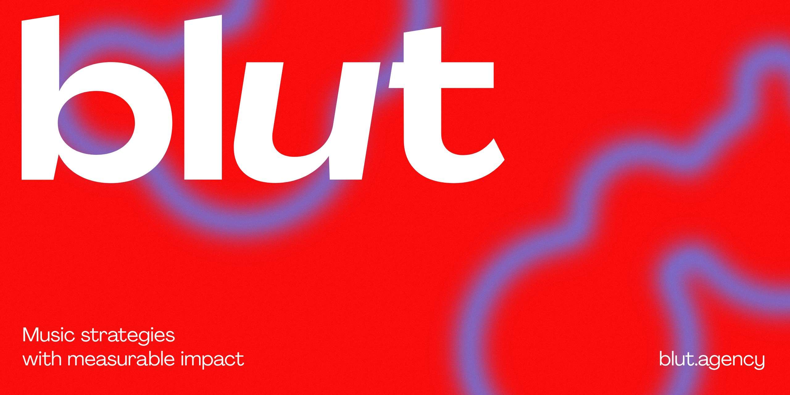</a>

  <a href="https://www.blut.agency"><b>blut.agency</b></a> · <a href="CHANGELOG.md">Changelog</a>

# blut

blut is a music-led creative agency from Hamburg, Berlin and Munich. We craft sonic identities and music strategies. We combine music production with data-driven performance measurement to boost brand impact.

This repository holds the blut website.

## The site

<table>
  <tr>
    <td width="50%"><b>Home</b> 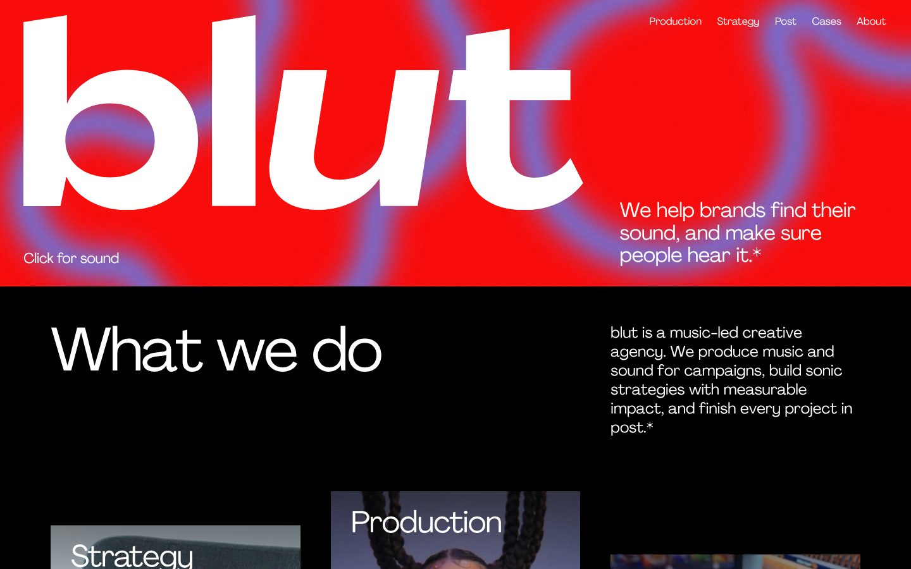</td>
    <td width="50%"><b>Production</b> 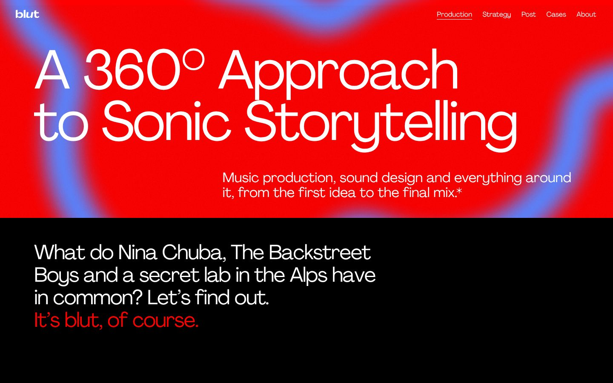</td>
  </tr>
  <tr>
    <td><b>Strategy</b> 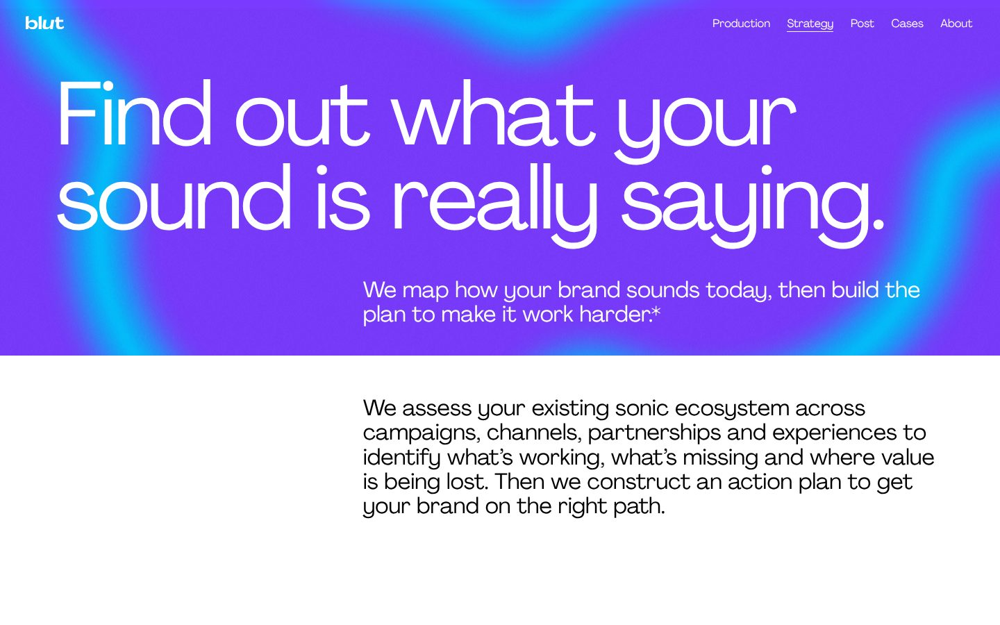</td>
    <td><b>Post</b> 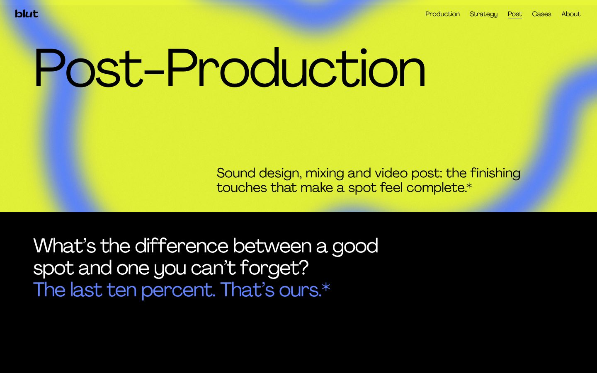</td>
  </tr>
  <tr>
    <td><b>Cases</b> 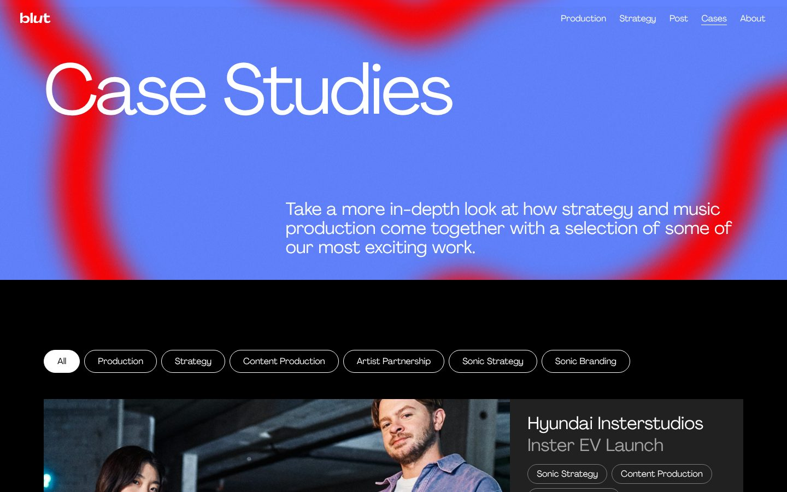</td>
    <td><b>Case study: Hyundai, Are You In?</b> 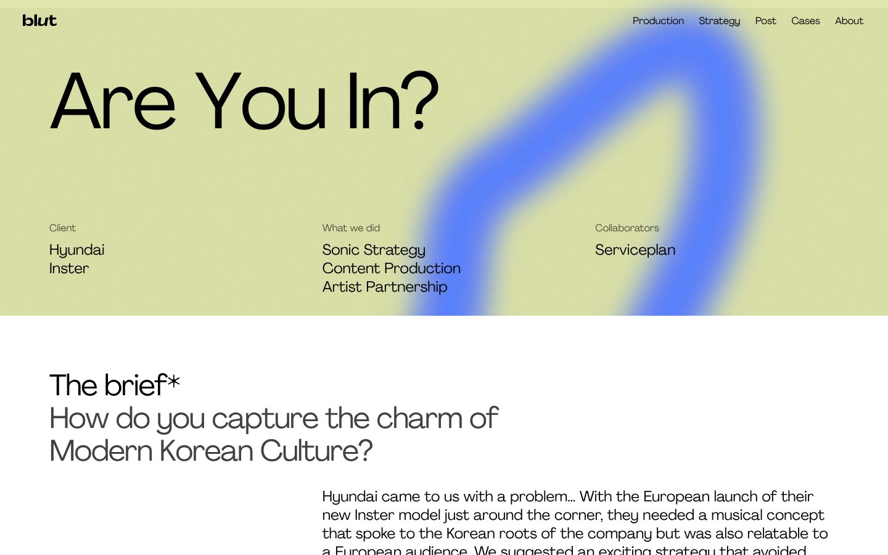</td>
  </tr>
  <tr>
    <td><b>About</b> 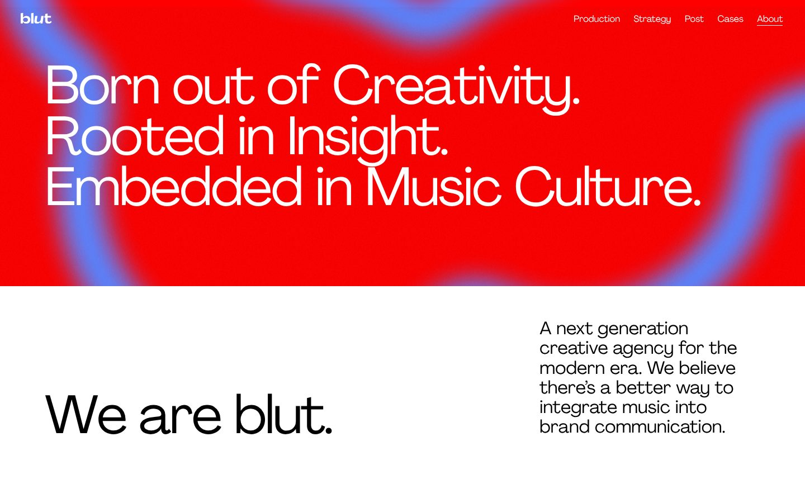</td>
    <td></td>
  </tr>
</table>

## On phones

<table>
  <tr>
    <td width="25%">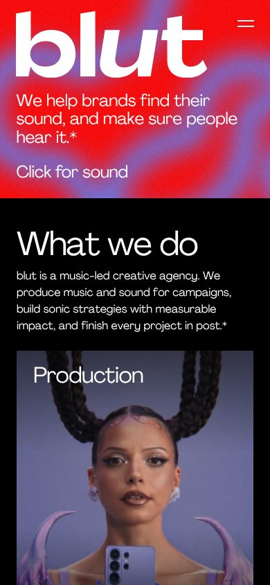</td>
    <td width="25%">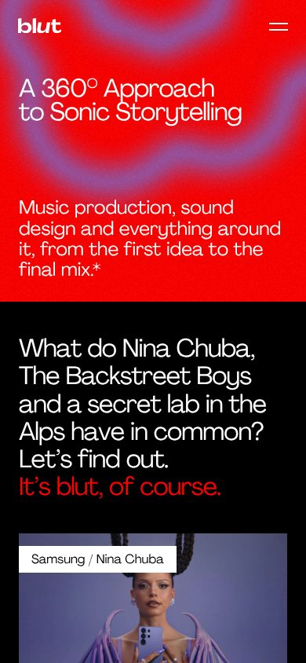</td>
    <td width="25%">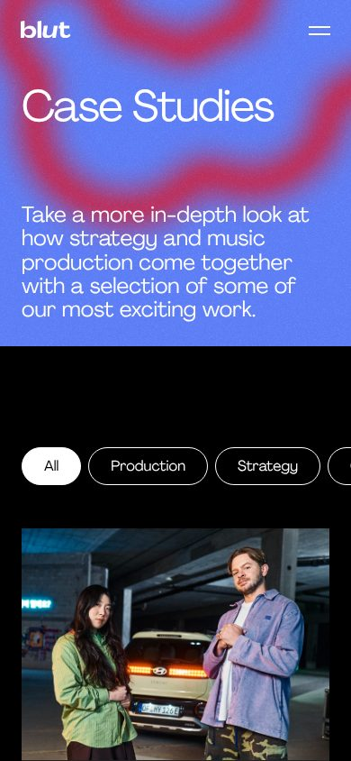</td>
    <td width="25%">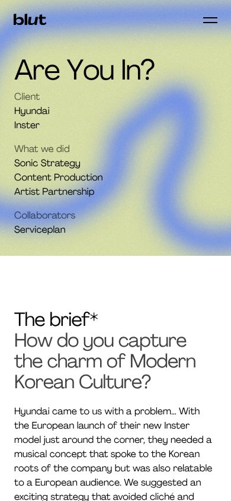</td>
  </tr>
</table>

## Pages

| Page | What it shows |
| --- | --- |
| [Home](https://www.blut.agency) | What blut does, and the featured cases |
| [Production](https://www.blut.agency/production) | Music and sound for campaigns |
| [Strategy](https://www.blut.agency/strategy) | Sonic strategy and performance measurement |
| [Post](https://www.blut.agency/post) | Sound design, mixing and video post |
| [Cases](https://www.blut.agency/case-studies) | Every case, with filters by service |
| [About](https://www.blut.agency/about) | The team |

## History

Every release is listed in the [changelog](CHANGELOG.md). Earlier design versions are kept as `archive/…` tags.
